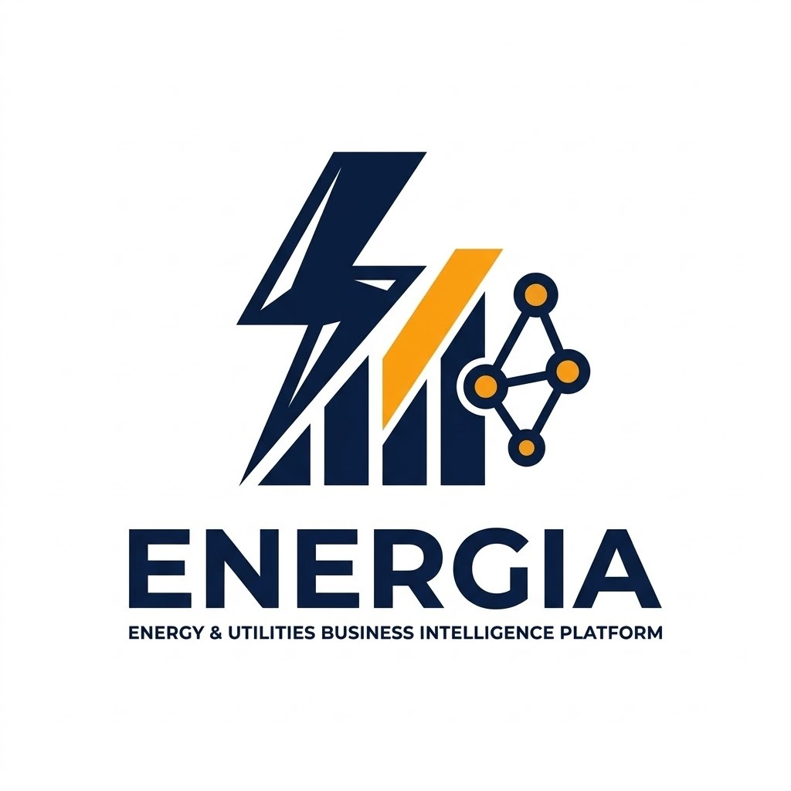

# ⚡ EnergIA — Plataforma de Analítica e Inteligencia de Negocios (Databricks & Web MVP)

## 🌐 Demo Interactiva en Vivo
👉 **[Explorar Dashboard Interactivo en Netlify](https://proyecto-integrador-betek-2026.netlify.app/)**

---

## 📌 Descripción del Proyecto
**EnergIA** es una solución analítica diseñada para el sector de distribución de energía eléctrica en Antioquia, Colombia. El proyecto integra datos históricos de 2021 sobre fallas en la red eléctrica, precipitación pluvial, estratificación socioeconómica y tarifas para mitigar pérdidas operativas por Energía No Suministrada (ENS).

Este repositorio contiene el flujo desarrollado bajo **arquitectura Medallón en Databricks**, las visualizaciones generadas en el entorno de notebooks y el **MVP web interactivo** desplegado en Netlify.

---

## 🏗️ Arquitectura y Flujo de Datos
1. **Capa Bronze:** Ingesta de datos crudos provenientes de registros climáticos, reportes de fallas en red, suscriptores y tarifas municipales.
2. **Capa Silver:** Limpieza, estandarización temporal y cruce relacional de fuentes dispersas.
3. **Capa Gold:** Construcción de tablas agregadas y cálculo de KPIs ejecutivos para visualización.
4. **Capa de Presentación (Web MVP):** Interfaz web responsiva con filtrado cruzado en tiempo real por municipio.

---

## 📊 Hallazgos Clave (Datos Históricos 2021)
* **$432 mil M COP** en pérdidas operativas e impacto por interrupciones analizadas.
* **74,25%** de cumplimiento en la continuidad del servicio eléctrico.
* **86,10%** de efectividad general en la resolución de incidencias.
* **24,18%** de las fallas asociadas directamente a picos de precipitaciones pluviales intensas.
* **Hubs críticos identificados:** Medellín, Bello, Caucasia y Apartadó.

---

## 🛠️ Tecnologías Utilizadas
* **Ingeniería y Analítica de Datos:** Databricks, Python, SQL, PySpark, Delta Lake.
* **Frontend & Visualización Web:** HTML5, CSS3, JavaScript, Chart.js, Leaflet.js (OpenStreetMap).
* **Despliegue:** Netlify.

---

## 📁 Estructura del Repositorio
* `Plataforma_Servicios_Publicos.ipynb` — Notebook principal con el procesamiento ETL bajo arquitectura Medallón y gráficas en Databricks.
* `capa_bronze/` — Fuentes de datos crudas de origen:
  * Códigos municipales (`DIVIPOLA`) y proyecciones poblacionales (`PPED-AreaMun`).
  * Histórico de tarifas de energía eléctrica y reportes operativos (`.csv`).
  * Registros meteorológicos históricos (`open_meteo_archive.json`, `open_meteo_medellin_2021-01.json`).
* `index.html`, `styles.css`, `script.js` — Código fuente del dashboard web interactivo.
* `logo.jpeg` — Identidad visual de EnergIA.

---

## 🔗 Repositorio Complementario
* 📊 **[Ver versión desarrollada en Power BI](https://github.com/ALEJO-2024/EnergIA-PowerBI)** *(Actualiza este enlace con la URL de tu repositorio de Power BI)*

---

## 👥 Equipo de Desarrollo
* **Oscar Alejandro Londoño Gil**
* **Diana Marcela Escudero**
* **Samuel David Ruiz**
* **Juliana Gómez**
